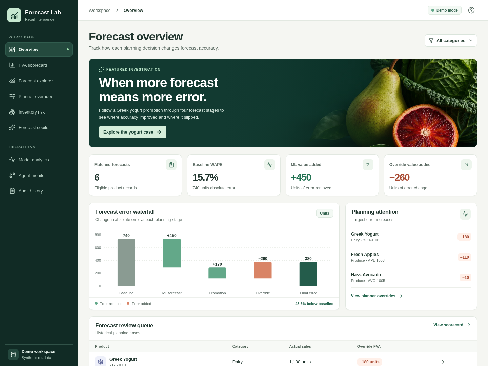

# Forecast Value Added Scorecard

Forecast Lab is a retail planning demonstration that measures how each forecast stage changes accuracy. It includes a historical override replay, a measured forecasting benchmark, an inventory simulation, and an evidence-linked copilot. All sales and planning data shipped here are synthetic.



## Guided walkthrough

1. Open **Explore the yogurt case** on the overview. Observed sales were 1,100 units.
2. Inspect the forecast versions and waterfall. The seasonal baseline of 850 produced 250 units of absolute error. ML at 1,000 removed 150. Promotion at 1,120 removed another 80. The original planner override at 1,300 added 180.
3. Enter 1,100 in **Historical replay**. The replay shows zero absolute error and +20 FVA versus the promotion forecast. This is a hindsight illustration.
4. Save the proposal, then open **Audit history** to record an approval in the browser.
5. Run an override investigation in **Forecast copilot**. Open the forecast lineage evidence or review the trace in **Agent monitor**.

## Run locally

The static demo requires Node.js 24 and works without API or model credentials.

```sh
npm ci
npm run dev
```

Open the URL printed by Vite. Use `npm run build` to produce the Pages artifact in `dist/`.

For the same-origin dashboard and backend, use Docker Compose and open `http://localhost:8080`. FastAPI includes OpenAPI documentation at `/docs`.

```sh
docker compose up --build --wait
```

If an organization intercepts registry HTTPS with a trusted internal CA, use a Compose overlay that declares a build secret named `build_ca` and points its file at the host's trusted PEM bundle. The Dockerfile mounts it for npm and pip during installation, with TLS verification enabled.

For Python development and data regeneration, use Python 3.12.

```sh
python -m venv .venv
. .venv/bin/activate
pip install -r requirements-dev.txt
python -m backend.engine --export src/demo.json
python -m backend.engine --records 1470 --sales /tmp/fva-sales.jsonl
python -m backend.warehouse /tmp/fva.duckdb /tmp/fva-sales.jsonl /tmp/fva-sales.parquet
python -m pytest -q
npm test
npx playwright install chromium
npm run test:e2e
```

Start the FastAPI dev server with `uvicorn backend.api:app --port 8000`. Start Vite with `VITE_USE_API=true npm run dev` to route replay and investigation through the local API.

## Measured model results

The benchmark uses 252 synthetic daily observations from three chronological 14-day windows across six SKUs. Forecast Explorer and Forecast Copilot include all 96 catalog items. The six original cases are hand-authored, and the remaining cases use reproducible synthetic forecast versions and observed sales. These cases are independent of the model benchmark.

| Model | WAPE | MAE | RMSE | MASE | Mean bias |
| --- | ---: | ---: | ---: | ---: | ---: |
| Seasonal naive | 8.71% | 8.76 | 12.11 | 0.97 | −0.58 |
| 7-day moving average | 9.56% | 9.62 | 11.79 | 1.07 | −0.33 |
| Gradient Boosting | 5.36% | 5.39 | 6.56 | 0.60 | −4.29 |

Gradient Boosting scored 5.02% WAPE on the final 84-observation holdout. P10–P90 coverage was 73.41% against nominal 80%, so these intervals were undercovered. The moving average had worse WAPE than the seasonal baseline.

## Deployment

The GitHub Actions workflow validates artifact regeneration, Python, browser and frontend tests, npm dependencies, and the production build. On `main` it can publish the static build when the repository's Pages source is configured to use GitHub Actions.

The [Cloud Run Terraform profile](infrastructure/cloud-run/main.tf) describes an IAM-gated deployment. It requires a billing-enabled GCP project, the Cloud Run and IAM APIs, a pushed container pinned by digest, and permissions for the deployment principal and image reader. Review a Terraform plan before applying it. The profile leaves invocation permissions to the project administrator.

See the [methodology, data dictionary, and architecture](docs/methodology.md) for data contracts, evidence boundaries, and implementation scope.

## Live demand lab

Open **Live demand lab** to run a continuous synthetic experiment. Switch between normal trade, promotion surge, and demand shift. The two forecasts are scored against the same simulated actuals, with decisions calculated before the actuals are generated. The comparison measures forecast error under the simulator's assumptions.

The browser and CLI cycle through all 96 catalog items. The live table opens with the latest event for each item and supports search by product, department, or SKU. The browser retains the last 600 observations and keeps a separate, arbitrary-precision event counter. The CLI uses the same generator and streams newline-delimited JSON with backpressure. Omit `--count` for a stream that runs until stopped or until its consumer closes. Use the next sequence number and the same regime to resume a segment. Keep the regime schedule externally if replaying a run with regime changes.

```sh
node scripts/demand-stream.mjs --regime 'Demand shift' --count 100000 > demand.ndjson
node scripts/demand-stream.mjs --regime 'Promotion surge' --start 9007199254740999 --count 3
node scripts/demand-stream.mjs | head -n 5
```

## Connect a live sales feed

The **Online forecasting** screen consumes server-sent forecast updates. An existing POS, warehouse job, or event consumer can submit one observation per series and daily period. Each series is a stable store/SKU identifier. Aggregate raw receipts upstream and send completed demand totals in increasing period order. Promotion flags reflect the observed period and the known plan for the next period.

Configure a strong `FVA_STREAM_TOKEN` in your environment or secret store, then start Compose. The same bearer token protects ingestion and forecast reads. Use HTTPS outside localhost.

```sh
docker compose up --build --wait
# Example feed. Replace this synthetic producer with your authorized source.
python -m backend.online_demo --records 1200 | python scripts/ingest-sales.py
```

Open **Online forecasting**, enter the token and `DEMO:SKU-1`, and connect. Keep publishing NDJSON to the ingestion script to see the model update as completed periods arrive. An example input record is:

```json
{"series":"DEMO:SKU-1","period":0,"units":133,"promotion":true,"next_promotion":true}
```

The model uses recursive least squares with a 0.985 forgetting factor, lagged demand, weekday indicators, and promotion plans. Each observation is compared to the forecast issued on the previous period before the model learns from it. After 21 observations, the model is compared against seasonal naive on the same outcomes. It produces a rolling nominal 90% band from prior residuals after another 20 scored observations. The screen shows actual historical band coverage, anomalies, and the difference between available inventory and the upper demand bound.

Ingestion accepts up to 512 events per request and 1,024 active series per process. The service skips repeated or older periods and rejects gaps without committing partial batches. Model state and recent residuals are held in memory. Use one process and retain a replayable upstream log. Durable checkpointing, stream partitioning, and multi-tenant access are outside this profile. GitHub Pages shows a recorded run generated with `python -m backend.online_demo --export src/online-demo.json`.

## Plan an item with your own data

**Demand planner** has 96 items across eight grocery departments. Select an item and enter one or more consecutive daily demand totals, oldest first. There is no fixed history-length limit. Forecast calculations use recent data and up to 56 backtest windows. Set stock on hand, lead time, and units per supplier pack. The input stays in the browser tab and is processed on demand. Every item also has labeled synthetic history.

The planner compares weekly seasonal, recent average, and damped trend forecasts when enough historical windows are available. Model selection and holdout target periods are disjoint. Holdout WAPE uses lead-time totals, with undefined accuracy when the actual denominator is zero. The historical-error range uses the 90th percentile of held-out absolute lead-time errors when at least eight windows are available. Overlapping holdout windows can be correlated, so the range is descriptive.

The order suggestion fills the gap between stock on hand and the upper estimate, rounding up to a full supplier pack. With fewer than seven days, the planner projects the observed daily average and labels the result provisional. When no error range is available it uses the point forecast. Use demand estimates when stockouts censored sales and check open orders and shelf life before buying. The catalog supports interactive planning. The [live sales feed](#connect-a-live-sales-feed) continues to accept operator-defined store and SKU IDs.

### Shared catalog model for short histories

In **Demand planner**, expand **Compare a model trained across 96 items** and choose the weekday of your latest observation. The comparison accepts 1–14 recent daily totals with positive demand. Optional promotion flags describe the latest observation and the entire upcoming lead time. Cohorts use the latest 1, 3, 7, or 14 days. All-zero or longer histories continue through the per-item planner.

The shared ridge model learns from lagged normalized demand, department, weekday, lead day, and observed or scheduled promotion flags. It trains on synthetic histories for 96 items, using days 0–99 as training targets, 100–149 for validation, and 150–209 as a separate holdout. The planner uses the shared forecast only when it beats the regular short-history baseline for that cohort and lead time on validation. The baseline uses a recent average for short histories and weekly seasonal forecasting when at least one week is available. The benchmark measures the combined benefits of sharing and using known calendar and promotion inputs. It does not isolate each input's contribution.

For one day of history and a seven-day lead time, the holdout contains 2,592 matched windows. The shared model scored 6.50% WAPE and the baseline scored 15.50%. These are synthetic results for later dates on the same assortment. They do not establish accuracy on real sales or unseen products. No user data is sent to a server or used to retrain the model. The shared model's order uses its point forecast and does not borrow the per-item uncertainty range.

Regenerate the browser artifact with `OPENBLAS_NUM_THREADS=1 python -m backend.catalog_model`.
