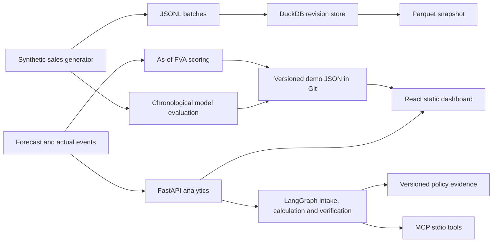

# Methodology and architecture

The benchmark reads generated events directly. The warehouse CLI demonstrates a separate ingestion path with a batch transaction, idempotent revision keys, conflict detection, a latest-version view, and Parquet export. A rerun can re-export a snapshot if the database commit succeeded but the file write failed.

## Data dictionary

| Record | Grain and fields | Provenance |
| --- | --- | --- |
| Generated sales | SKU and date, units, promotion flag, available date | Seeded generator with seasonal, promotional and trend terms |
| DuckDB revision | SKU, date, available date key, units, promotion flag | Validated daily sales batches |
| Forecast version | SKU, target date, stage, issued UTC timestamp, units | Authored synthetic weekly planning scenario |
| Actual version | SKU, target date, available UTC timestamp, units, completeness | Authored synthetic weekly outcome |
| Local proposal | Browser ID, SKU, proposed units, historical FVA, recorded time and status | Planner interaction on the demo |
| Benchmark artifact | WAPE, MAE, RMSE, MASE, signed bias, pinball loss, interval coverage and sample count | Reproducible model evaluation |

The generator streams up to ten million records from six fictional SKUs. Record count increases the generated daily horizon. The supplied artifact uses 245 days and 1,470 records. To extend with public data, obtain [M5 Forecasting Accuracy](https://www.kaggle.com/competitions/m5-forecasting-accuracy/data) or [Corporación Favorita Grocery Sales Forecasting](https://www.kaggle.com/competitions/favorita-grocery-sales-forecasting/data) from the respective competition's Data tab after reviewing its access terms. Cite the organizers and validate an explicit schema mapping before ingestion. The shipped benchmark uses generated sales exclusively.

## Scoring

FVA equals the previous stage's absolute error minus current-stage absolute error. WAPE divides total absolute error by total observed units, with a null result when the denominator is zero. Portfolio bias sums signed forecast minus actual. The benchmark reports mean signed bias in units per observation.

Scoring selects the newest version issued by the shared decision cutoff and the most recent actual available at the reporting cutoff. Every stage shares one population. Eligibility requires a complete actual and a baseline, ML, and promotion forecast. A missing override carries the promotion stage forward for portfolio scoring. Override-only scoring uses actual override records and reports coverage, wins, and ties. The weekly forecast fixture assumes canonical ISO UTC strings.

## Model card

The global gradient boosting model uses SKU index, day of week, a known synthetic promotion plan, and lag-1 and lag-7 sales. It predicts one day ahead. As each new day starts, the preceding day's sales are assumed available. Training dates precede each evaluation window. Hyperparameters are fixed, and the third window serves as the final holdout. MASE uses each training window's mean seasonal naive absolute error as its scaling factor. Independent quantile models produce P10 and P90, ordered at evaluation when they cross. Undercoverage limits the interval's suitability for service-level planning.

Inventory simulation evaluates a discrete set of immediate orders against pooled daily empirical demand from the final evaluation window. It minimizes mean linear shortage and surplus costs under the configured maximum. It does not establish savings or estimate a live SKU's demand. Expected surplus is a proxy for exposure to waste.

## Evidence and security

The API's LangGraph nodes select eligible records, calculate the error change, and verify that the evidence keys match. The final node returns the associated versioned fictional policy. The browser-only mode computes the same historical arithmetic on the exported data. Run `python -m backend.mcp_server` from the repository root to serve read-only tools over MCP stdio.

FastAPI accepts bounded fields and known stage values. The backend exposes analytics and read-only replay. Browser approval is a simulated status stored in local storage. There is no server-side publication action, credential dependency, or employer data. Cloud Run access requires IAM invocation permission.

The current scope is the demonstrable vertical slice. Public-dataset adapters, distributed data pipelines, additional forecasting families, hosted LLM and semantic retrieval adapters, server-side identity and approvals, model registry and observability integrations, and managed GCP data services are outside the delivered implementation.
